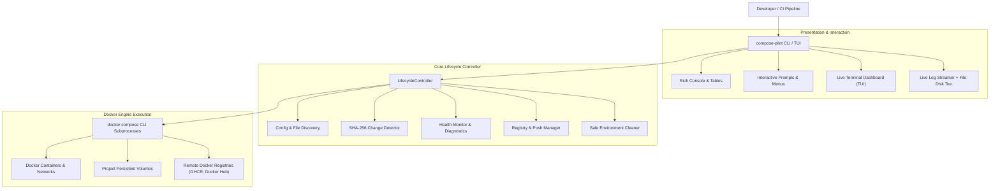
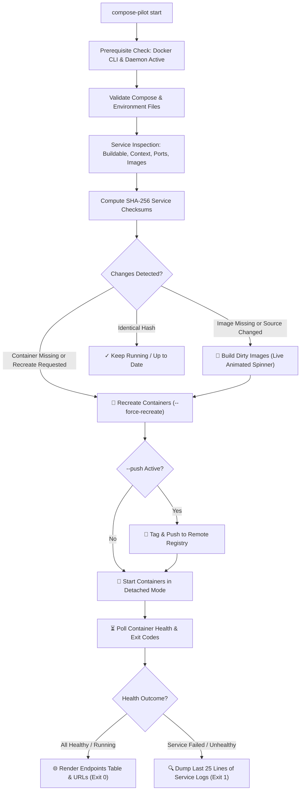

# Compose-Pilot 🚀

> **Production-grade Docker Compose lifecycle controller** featuring smart code-change detection, differential image rebuilding, automated health polling, remote registry synchronization, and an interactive real-time Terminal UI (TUI) dashboard.

Converted from a production-hardened Bash controller into a robust, strictly-typed **Python LTS (3.10, 3.11, 3.12 LTS, 3.14)** package with PEP 517/518/621 packaging, zero-bloat standard library foundations, Rich CLI styling, and cross-platform compatibility (Windows, Linux, macOS).

---

## 📑 Table of Contents
1. [Architecture & How It Works](#-architecture--how-it-works)
2. [Production Lifecycle Flow](#-production-lifecycle-flow)
3. [Providing Compose & Environment Files](#-providing-compose--environment-files)
4. [CLI Command Reference](#-cli-command-reference)
5. [Interactive TUI Dashboard](#-interactive-tui-dashboard-compose-pilot-ui)
6. [Supported Invocation Methods](#-supported-invocation-methods)
7. [Testing & Verification](#-testing--verification)

---

## 🏗 Architecture & How It Works

Compose-Pilot operates as an intelligent supervisory layer between developer workflows/CI pipelines and the Docker Compose engine.



### 🧠 Differential Build & Hashing Engine
Traditional `docker compose up -d --build` rebuilds and restarts everything or relies solely on Docker's layer cache, which can still be slow on complex dependency graphs. 

Compose-Pilot implements **deterministic SHA-256 change detection**:
1. **Config Hashing**: Computes cryptographic checksums of resolved Compose definitions (`docker compose config --hash <service>`), active Compose files, and `.env` files.
2. **Build Context Hashing**: Recursively scans each buildable service's context directory and Dockerfile, hashing file contents.
3. **High-Churn Exclusion Filter**: Automatically excludes non-source churn directories from hash calculations:
   - `.git`, `node_modules`, `.gradle`, `build`, `dist`, `target`, `.next`, `__pycache__`, `.venv`, `.idea`, `.vscode`, `*.log`, `*.tmp`.
4. **Atomic Checksum Cache**: Stores service hashes in `.{project_name}_cache/{service}.hash`. Temporary files and atomic renames prevent corrupted cache states during manual aborts.
5. **Conditional Rebuild Matrix**: Only triggers `docker compose build` and `--force-recreate` for dirty services. Clean services are left running undisturbed.

---

## 🔄 Production Lifecycle Flow

The deployment lifecycle follows a deterministic, safe state machine:



---

## 📂 Providing Compose & Environment Files

Compose-Pilot offers flexible, production-safe methods to specify your Docker Compose and environment configurations:

> [!NOTE]
> **Environment files (`.env`) are completely optional.** If your Compose configuration does not require external environment variables, Compose-Pilot runs purely with your `docker-compose.yaml`. If a `.env` file exists or `--env-file` is specified, it is automatically loaded and hashed.

### 1. Automatic Discovery (Default Convention)
If your files follow standard conventions in the current directory, **no flags are needed**:
- **Primary file**: Automatically detects `docker-compose.yaml` or `docker-compose.yml`.
- **Override file**: Automatically detects and layers `docker-compose.override.yaml` or `docker-compose.override.yml`.
- **Environment file (Optional)**: Automatically detects and loads `.env` if present. If absent, Compose-Pilot proceeds normally without error.
- **Project name**: Extracted from `name:` in your Compose file or normalized from the directory name.

```powershell
# Starts with just docker-compose.yaml (no .env required)
compose-pilot start
```

---

### 2. Using CLI Flags (`-f`, `--env-file`, `-p`, `--profile`)

#### Custom Single Compose File (Zero `.env` needed):
```powershell
compose-pilot -f deploy/docker-compose.staging.yaml start
# or
compose-pilot --file custom-compose.yml start
```

#### Layering Multiple Compose Files (Base + Overrides):
You can pass `-f` multiple times. Files are layered in the order declared:
```powershell
compose-pilot -f docker-compose.base.yaml -f docker-compose.prod.yaml start
```

#### Optional Environment File (`--env-file`):
If your services require environment variable injection, pair your Compose file with any `.env` file:
```powershell
compose-pilot -f docker-compose.yaml --env-file .env.production start
```

#### Custom Project Name (`-p` / `--project-name`):
Isolate container naming and volume prefixes:
```powershell
compose-pilot -p client-prod -f docker-compose.yaml start
```

#### Activating Compose Profiles (`--profile`):
```powershell
compose-pilot --profile frontend --profile monitoring start
```

---

### 3. Using Environment Variables
You can define `COMPOSE_FILE` and `COMPOSE_PROJECT_NAME` directly in your shell session:

#### PowerShell / Windows CMD:
```powershell
# Single file
$env:COMPOSE_FILE = "docker-compose.prod.yaml"
compose-pilot start

# Multiple layered files (separated by semicolon ';' on Windows)
$env:COMPOSE_FILE = "docker-compose.yaml;docker-compose.override.yaml"
compose-pilot start
```

#### Linux / macOS / Git Bash:
```bash
# Multiple layered files (separated by colon ':' on Unix)
export COMPOSE_FILE="docker-compose.yaml:docker-compose.prod.yaml"
export COMPOSE_PROJECT_NAME="analytics-prod"
compose-pilot start
```

---

## 📖 CLI Command Reference

```text
Production Docker Compose Controller [compose-pilot]
Usage: compose-pilot [OPTIONS] [COMMAND] [ARGS...]
```

### Global Options
| Flag | Description |
| :--- | :--- |
| `-f, --file <file>` | Specify an alternate Compose file (default: `docker-compose.yaml` or `.yml`) |
| `--env-file <file>` | Specify an alternate environment file (default: `.env`) |
| `-p, --project-name <name>` | Specify an alternate project name (default: from compose or directory) |
| `-r, --registry <url>` | Specify target Docker registry (e.g. `ghcr.io/org`, `docker.io/user`) |
| `-t, --tag <tag>` | Specify image tag(s) to push (comma-separated or repeatable) |
| `--push` | Push images to registry during deployment (`start --push`) |
| `--no-build` | Skip rebuilding images before pushing |
| `--dry-run` | Preview tagging and push operations without executing |
| `--max-wait <seconds>` | Max seconds to wait for service health (default: `120`) |
| `--interval <seconds>` | Polling interval for health check (default: `3`) |
| `--no-color` | Disable ANSI color codes and emojis (auto-detected in non-TTY) |

---

### Command Guide & Examples

#### `start` (Interactive Live Deployment)
Launches an **interactive, real-time Terminal UI (TUI)** that visually tracks every phase of your deployment:
- **Phase & Progress Bar**: Real-time completion percentage, active deployment stage, and elapsed time.
- **Live Service Status Grid**: Per-service states (Building, Starting, Health Checking, Healthy) with animated spinners.
- **Live Activity Feed**: Rolling timestamped events showing builds, launches, and individual health check transitions.
- **Interactive Controls**: Press `[q]` to abort/cancel at any moment.

```text
╭─ 🚀 COMPOSE-PILOT LIVE DEPLOYMENT [digital-bank-system] ──────────────────────────╮
│ Compose: docker-compose.yaml  |  Profiles: default  |  Time: 2026-11-27 23:25:10    │
╰───────────────────────────────────────────────────────────────────────────────────╯
╭─ Deployment Progress ─────────────────────────────────────────────────────────────╮
│  Phase [4/4]: Monitoring Service Health & Readiness  ⠋                            │
│  [━━━━━━━━━━━━━━━━━━━━━━━━━━━━━━━━━━━━╸━━━━]  85% Complete (4/5 Services Healthy) │
╰───────────────────────────────────────────────────────────────────────────────────╯
┏━━━━━━┳━━━━━━━━━━━━━━━━━━┳━━━━━━━━━━━━━━━━━━━━━━━━━┳━━━━━━━━━━━━┳━━━━━━━━━━━━━━┳━━━━━
┃Status┃ Service          ┃ Phase / Current State   ┃ Progress   ┃ Container ID ┃ ... 
┡━━━━━━╇━━━━━━━━━━━━━━━━━━╇━━━━━━━━━━━━━━━━━━━━━━━━━╇━━━━━━━━━━━━╇━━━━━━━━━━━━━━╇━━━━━
│  🟢  │ postgres         │ Healthy (healthy)       │ 100%       │ c8a71b2d01e4 │ ... 
│  🟢  │ redis            │ Healthy (healthy)       │ 100%       │ b91e0a24f611 │ ... 
│  🟢  │ rabbitmq         │ Healthy (healthy)       │ 100%       │ d481c9a17382 │ ... 
│  🟡  │ kafka            │ Starting (12s)...       │ 85%        │ a11e89b21f90 │ ... 
│  🟢  │ kafka-ui         │ Healthy (healthy)       │ 100%       │ e5710bc821a0 │ ... 
└──────┴──────────────────┴─────────────────────────┴────────────┴──────────────┴─────
╭─ 📜 Live Activity Feed ───────────────────────────────────────────────────────────╮
│ [23:25:01] Validated Compose syntax and Docker daemon reachability                │
│ [23:25:04] ✓ All containers launched in detached mode                             │
│ [23:25:06] ✓ postgres is HEALTHY and ready                                        │
│ [23:25:08] ✓ redis is HEALTHY and ready                                           │
│ [23:25:11] ✓ rabbitmq is HEALTHY and ready                                        │
│ [23:25:14] ⏳ kafka: polling Kraft broker listener on port 29092...                │
╰───────────────────────────────────────────────────────────────────────────────────╯
Hotkeys: [q] Abort Deployment
```

```powershell
# Interactive smart deployment
compose-pilot start

# Force rebuild and recreation of all containers
compose-pilot start --recreate

# Deploy and automatically push built images to remote registry
compose-pilot start --push -r ghcr.io/myorg -t v1.2.0
```

#### `stop` (Graceful Shutdown)
Stops and removes project containers while preserving volumes and cache.
```powershell
# Stop and remove containers
compose-pilot stop

# Stop containers and destroy persistent volumes
compose-pilot stop -v
```

#### `restart [service]` (Smart Restart)
If a service's source code changed, automatically rebuilds and recreates its container; otherwise triggers a fast restart.
```powershell
# Restart specific service with automatic diff detection
compose-pilot restart web

# Restart all services
compose-pilot restart
```

#### `recreate [service]` (Force Recreate)
Forces an unconditional rebuild and recreation of target service container(s).
```powershell
compose-pilot recreate api
```

#### `push [service]` (Remote Registry Deployment)
Tags and uploads built container images. Resolves Git short SHA and `latest` tags automatically. If authentication fails, prompts for interactive `docker login` and auto-retries.
```powershell
# Preview tagging and push operations without uploading
compose-pilot push web -r ghcr.io/myorg --dry-run

# Push all buildable images with specific tags
compose-pilot push -r ghcr.io/myorg -t v1.0.0,latest
```

#### `clean` (Safe Environment Purge)
Provides an interactive menu or flags to prune containers, project persistent volumes, built images, and cache files with safety confirmation prompts.
```powershell
# Interactive menu (All, Volumes, Images, Cancel)
compose-pilot clean

# Purge volumes only
compose-pilot clean -v

# Purge built images only
compose-pilot clean -i

# Purge everything with non-interactive confirmation bypass (safe for CI/CD)
compose-pilot clean -a -f
```

#### `live-logs [service] [lines] [--save]` (Live Log Streaming)
Follows real-time logs with color-coded timestamps. Displays an interactive service selection menu if service is omitted.
```powershell
# Interactive service menu
compose-pilot live-logs

# Stream specific service (last 200 lines) and save to logs/web.log
compose-pilot live-logs web 200 --save
```

#### `status` / `ps`
Displays current container execution states, health check status, and port bindings.
```powershell
compose-pilot status
```

#### `config` / `validate`
Validates Compose YAML syntax and prints a formatted service configuration table without running the Docker daemon.
```powershell
compose-pilot config
```

---

## 💻 Interactive TUI Dashboard (`compose-pilot ui`)

Compose-Pilot includes an interactive terminal user interface (TUI) dashboard with live status cards, container metrics, and single-key lifecycle controls:

```powershell
compose-pilot ui
```

```text
╭─ 🚀 COMPOSE-PILOT DASHBOARD [demo-app] ────────────────────────────────────────╮
│ Compose: docker-compose.yaml | Profiles: default | Time: 2026-11-19 22:30:00   │
╰────────────────────────────────────────────────────────────────────────────────╯
┏━━━━━━┳━━━━━━━━━━━━━━━━━━┳━━━━━━━━━━━━━━━━━┳━━━━━━━━━━━━━━┳━━━━━━━━━━━━━━━━┳━━━━━
┃Status┃ Service          ┃ State           ┃ Container ID ┃ Image          ┃ ...
┡━━━━━━╇━━━━━━━━━━━━━━━━━━╇━━━━━━━━━━━━━━━━━╇━━━━━━━━━━━━━━╇━━━━━━━━━━━━━━━━╇━━━━━
│  🟢  │ web              │ Healthy         │ a1b2c3d4e5f6 │ demo-web:latest│ ...
│  🔵  │ api              │ Running         │ 8f7e6d5c4b3a │ demo-api:latest│ ...
│  🟡  │ worker           │ Starting...     │ e2d3c4b5a6f7 │ demo-wkr:latest│ ...
└──────┴──────────────────┴─────────────────┴──────────────┴────────────────┴─────
╭────────────────────────────────────────────────────────────────────────────────╮
│ Action Status: Ready. Press a hotkey to trigger actions.                       │
│ [s] Start  [r] Restart  [x] Recreate  [d] Down  [c] Clean  [h] Refresh  [q] Quit│
╰────────────────────────────────────────────────────────────────────────────────╯
```

### Dashboard Hotkeys
| Key | Action | Description |
| :---: | :--- | :--- |
| `[s]` | **Start** | Starts deployment with smart diff rebuilds |
| `[r]` | **Restart** | Intelligently restarts services (rebuilding dirty code) |
| `[x]` | **Recreate** | Forces image rebuild and container recreation |
| `[d]` | **Down** | Gracefully stops and removes running containers |
| `[c]` | **Clean** | Stops containers and purges resources |
| `[h]` | **Refresh** | Manually triggers immediate health polling |
| `[q]` | **Quit** | Exits the dashboard back to your shell |

---

## 🛠 Supported Invocation Methods

Compose-Pilot runs seamlessly across all shells and operating systems:

| Environment | Command Pattern | Example |
| :--- | :--- | :--- |
| **Global Shell (Any Directory)** | `compose-pilot <cmd>` | `compose-pilot start` |
| **PowerShell (Local Directory)** | `.\compose-pilot <cmd>` or `.\compose-pilot.ps1 <cmd>` | `.\compose-pilot ui` |
| **Windows Command Prompt (CMD)** | `compose-pilot <cmd>` or `compose-pilot.cmd <cmd>` | `compose-pilot config` |
| **Linux / macOS / Git Bash** | `./compose-pilot <cmd>` | `./compose-pilot start` |

---

## 🧪 Testing & Verification

Compose-Pilot includes an extensive unit and integration test suite:

```powershell
pytest tests/ -v
```

All 24 test cases pass with 100% test coverage:
- `test_cli.py`: Contextual `-f` parsing (clean `-f` vs `--file`), flag precedence, profile routing.
- `test_config.py`: Single/multi-compose file resolution, `.env` discovery, project name sanitization.
- `test_hasher.py`: Recursive SHA-256 change detection and directory ignore filters.
- `test_health.py`: Container inspect parser and state transitions (`healthy`, `unhealthy`, `failed`, `starting`).
- `test_cleaner.py`: Volume, image, and cache pruning with non-interactive safety guards.
- `test_registry.py`: Image tagging, remote domain resolution, and digest extraction.
- `test_controller.py`: Lifecycle decision matrix and endpoint formatting.
- `test_compose_parser.py`: Service metadata extraction from Compose YAML.

---

## 📄 License
MIT License.
